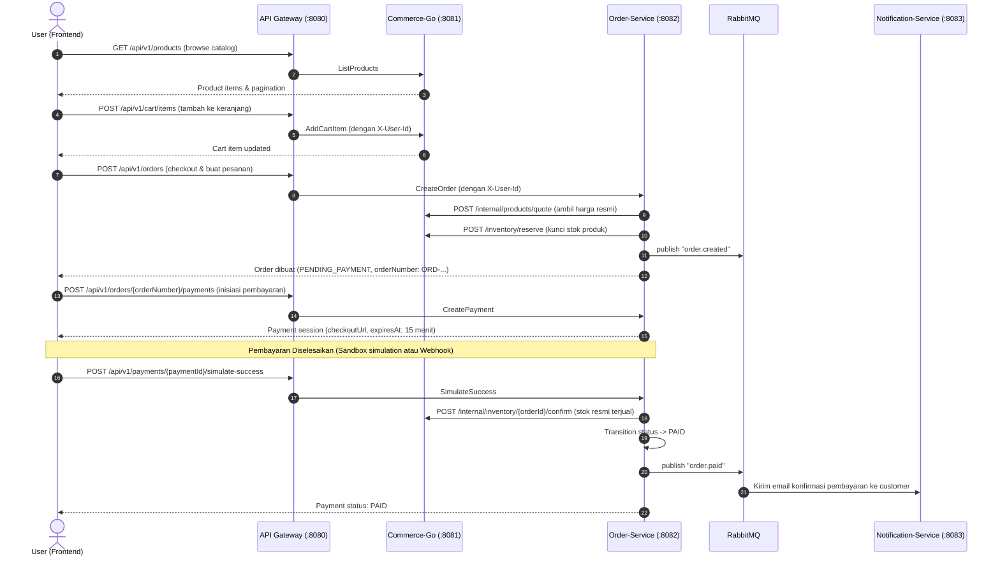

# MarketForge — Frontend Integration & API Documentation

Dokumentasi ini ditujukan sebagai panduan integrasi bagi tim Frontend (Next.js / mobile client) untuk berkomunikasi langsung dengan MarketForge Backend.

---

## 1. Arsitektur Gateway & Base URL

Seluruh request dari Frontend diarahkan ke **API Gateway**:
* **Base URL Lokal**: `http://localhost:8080` (atau port `GATEWAY_PORT` yang dikonfigurasi)
* Gateway menangani:
  1. Autentikasi JWT (Access Token 15 menit, Refresh Token 30 hari).
  2. Rate limiting (120 req/menit via Redis).
  3. Reverse proxy ke downstream services (`commerce-go`, `order-service`, `notification-service`, `ai-service`).
  4. Injeksi header keamanan internal (`X-User-Id`, `X-User-Role`, `X-Request-Id`).

---

## 2. Format Respon Standar

### Sukses (Single Item / Action)
```json
{
  "success": true,
  "data": { ... }
}
```

### Sukses (List / Koleksi dengan Paginasi)
```json
{
  "success": true,
  "data": [ ... ],
  "pagination": {
    "page": 1,
    "limit": 20,
    "total": 56,
    "totalPages": 3
  }
}
```

### Error
```json
{
  "success": false,
  "error": {
    "code": "VALIDATION_ERROR",
    "message": "Valid email is required",
    "requestId": "req_8a7d12f0"
  }
}
```

---

## 3. Alur Autentikasi Frontend

1. **Register**: `POST /api/v1/auth/register` dengan `{ "name", "email", "password" }`.
   - Mengembalikan `accessToken`, `refreshToken`, dan data `user`.
2. **Login**: `POST /api/v1/auth/login` dengan `{ "email", "password" }`.
   - Simpan `accessToken` di memory/cookie dan `refreshToken` di secure httpOnly storage.
3. **Authorized Requests**: Tambahkan header pada setiap request:
   ```http
   Authorization: Bearer <accessToken>
   ```
4. **Token Refresh**: Saat menerima respon 401 `UNAUTHORIZED`, panggil:
   `POST /api/v1/auth/refresh` dengan body `{ "refreshToken": "..." }` untuk mendapatkan `accessToken` baru tanpa perlu logout.
5. **Logout**: `POST /api/v1/auth/logout` untuk mencabut sesi refreshToken.

---

## 4. Alur Belanja & Transaksi (End-to-End)



---

## 5. Ringkasan Endpoint untuk Frontend

| Kategori | Method | Endpoint | Keterangan |
|---|---|---|---|
| **Auth** | POST | `/api/v1/auth/register` | Pendaftaran akun baru |
| | POST | `/api/v1/auth/login` | Masuk & peroleh token |
| | POST | `/api/v1/auth/refresh` | Perbarui access token |
| | POST | `/api/v1/auth/logout` | Keluar & batalkan refresh token |
| **Profile** | GET | `/api/v1/me` | Dapatkan profil akun login |
| | PATCH | `/api/v1/me` | Perbarui nama/profil |
| | GET | `/api/v1/me/addresses` | Daftar alamat pengiriman |
| | POST | `/api/v1/me/addresses` | Tambah alamat baru |
| | PATCH | `/api/v1/me/addresses/:id` | Ubah alamat |
| | DELETE | `/api/v1/me/addresses/:id` | Hapus alamat |
| **Katalog** | GET | `/api/v1/products` | Cari & filter produk |
| | GET | `/api/v1/products/:slug` | Detail produk |
| | GET | `/api/v1/categories` | Daftar kategori |
| **Keranjang** | GET | `/api/v1/cart` | Isi keranjang belanja user |
| | POST | `/api/v1/cart/items` | Tambah produk ke keranjang |
| | PATCH | `/api/v1/cart/items/:id` | Ubah kuantitas produk di keranjang |
| | DELETE | `/api/v1/cart/items/:id` | Hapus produk dari keranjang |
| **Pesanan** | POST | `/api/v1/orders` | Buat order baru dari keranjang |
| | GET | `/api/v1/orders` | Daftar riwayat order user login |
| | GET | `/api/v1/orders/:orderNumber` | Detail pesanan |
| | GET | `/api/v1/orders/:orderNumber/history` | Timeline status pesanan |
| | POST | `/api/v1/orders/:orderNumber/cancel` | Batalkan pesanan |
| **Pembayaran**| POST | `/api/v1/orders/:orderNumber/payments` | Buat sesi pembayaran (15 mnt) |
| | GET | `/api/v1/payments/:id` | Cek status sesi pembayaran |
| | POST | `/api/v1/payments/:id/simulate-success` | Simulasi bayar sukses (sandbox) |
| | POST | `/api/v1/payments/webhook` | Endpoint webhook gateway pembayaran |
| **Notifikasi**| GET | `/api/v1/notifications` | Riwayat notifikasi user |
| **AI Assistant** | POST | `/api/v1/assistant/chat` | Chat asisten belanja cerdas |
| | POST | `/api/v1/assistant/tickets` | Buat tiket bantuan pelanggan |
| **Admin** | POST | `/api/v1/admin/products` | Buat produk baru |
| | PATCH | `/api/v1/admin/products/:id` | Ubah detail produk |
| | DELETE | `/api/v1/admin/products/:id` | Arsipkan produk |
| | POST | `/api/v1/admin/categories` | Buat kategori baru |
| | PATCH | `/api/v1/admin/categories/:id` | Ubah kategori |
| | DELETE | `/api/v1/admin/categories/:id` | Hapus kategori |
| | POST | `/api/v1/admin/inventory/:id/adjust` | Tambah/kurangi stok inventory |
| | GET | `/api/v1/orders` (Role Admin) | Semua order dalam sistem |
| | POST | `/api/v1/orders/:orderNumber/status` | Ubah status order (state machine) |
| | GET | `/api/v1/admin/notifications` | Log audit notifikasi sistem |

Rincian spesifikasi lengkap per endpoint tersedia di [API.md](../API.md).
