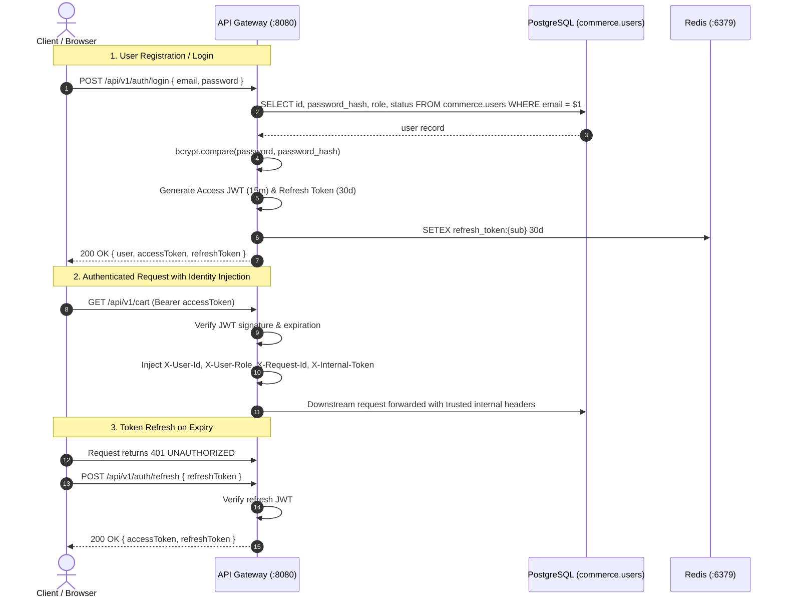
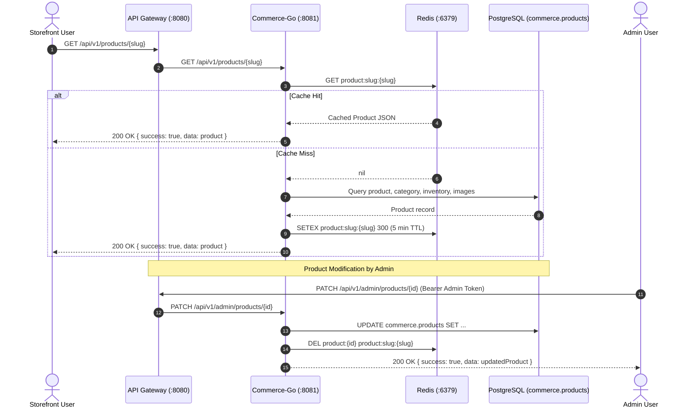
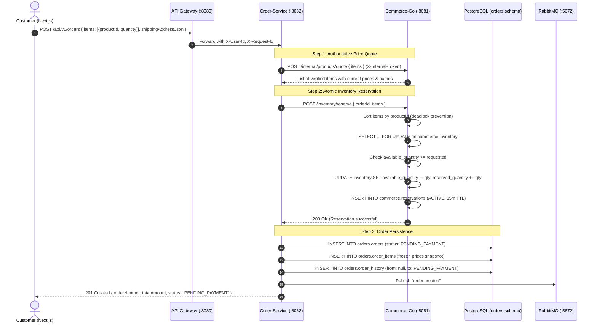
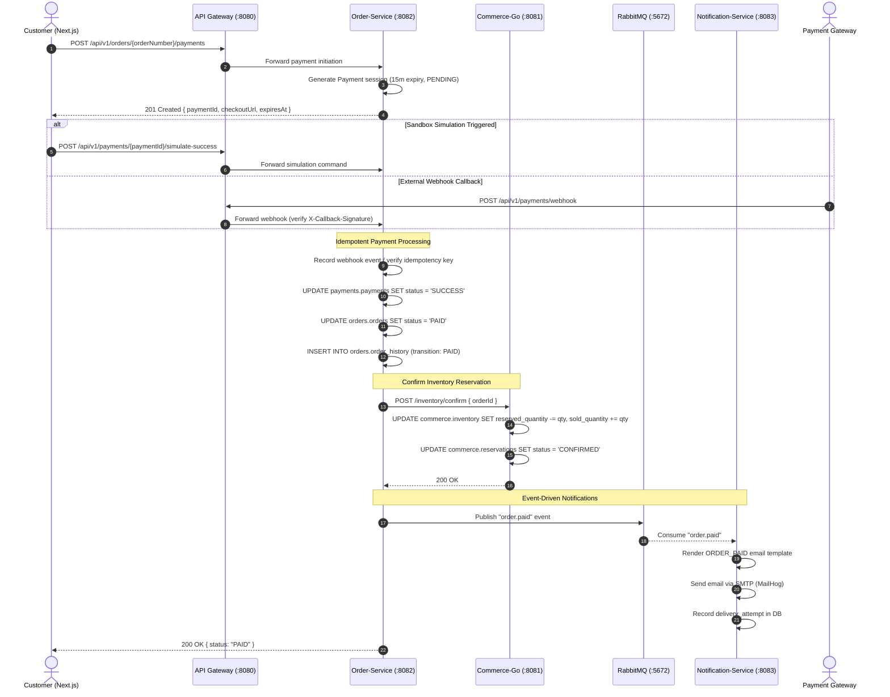
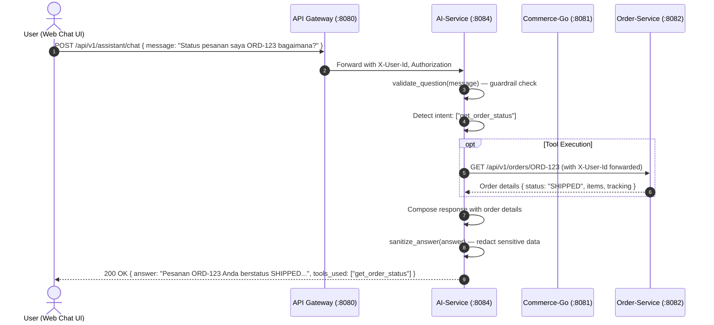

# MarketForge — Architecture Deep-Dive & Flow Diagrams

This document provides detailed sequence diagrams and flow specifications for the primary interactions across MarketForge's polyglot microservices.

---

## 1. User Authentication & Session Flow

All authentication traffic enters through the **API Gateway** (`apps/gateway`), which handles password verification, JWT issuance, and token refresh.

---

## 2. Product Catalog, Search & Cache-Aside Flow

The Core Commerce Service (`apps/commerce-go`) serves the product catalog with Redis caching and explicit invalidation.

---

## 3. End-to-End Checkout & Transaction Flow

The transactional core coordinates between `order-service` and `commerce-go` to guarantee price authority and inventory reservation.

---

## 4. Payment Lifecycle & Reservation Confirmation

MarketForge supports sandbox payment sessions with instant simulation or asynchronous webhook callbacks.

---

## 5. AI Assistant Tool Calling Architecture

The AI assistant never queries the database directly. It extracts intent, validates questions against safety guardrails, and executes internal API tools carrying the authenticated user's identity.

